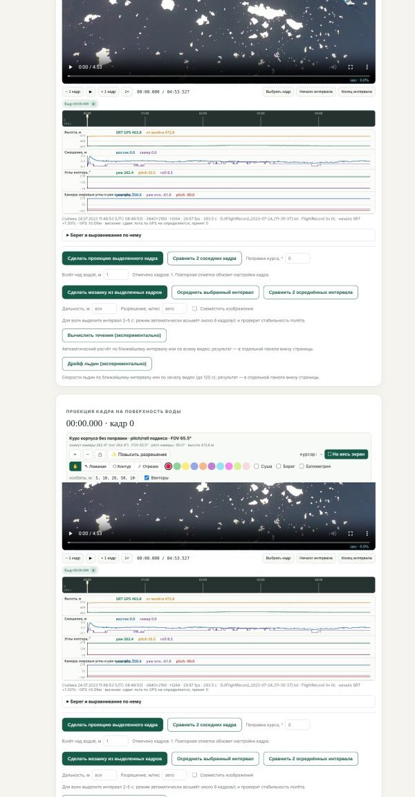
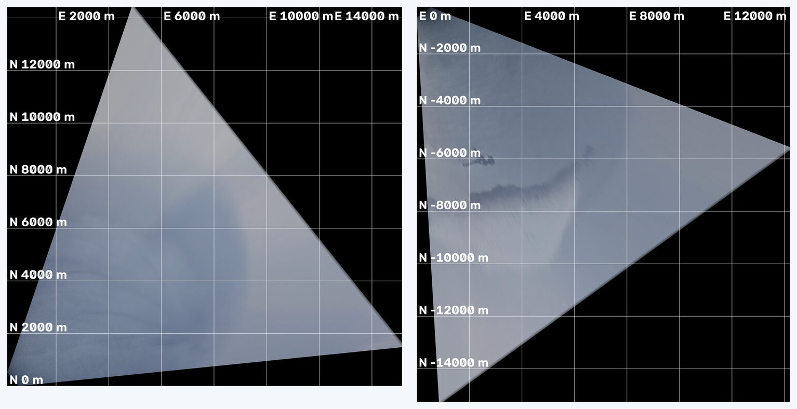

# DroneVision

Программа для геопривязки видео с дронов DJI: переносит кадры на карту в метрах и градусах и измеряет по ним
то, что видно на воде. Работает в браузере, но полностью на вашем компьютере — видео и логи никуда не отправляются.

## Что умеет

- **Проекция кадра** на поверхность воды: картинка «вид сверху» с сеткой, координатами, сушей, береговой линией и выбранными изобатами GEBCO.
- **Мозаика** из нескольких кадров и **осреднение** интервала видео (убирает блики и волны).
- **Сравнение** двух кадров или двух осреднённых интервалов на одной сетке: видно, что сдвинулось.
- **Разметка**: отрезки, ломаные и контуры; профили яркости вдоль линий, их совмещение и сравнение.
- **Смещение и скорость** отмеченных объектов (сликов, пены, льдин) между двумя кадрами.
- **Течения и спектр ветровых волн** по интервалу видео (экспериментально).
- **Дрейф льдин**: поле скоростей льдин по интервалу видео (экспериментально).
- **Экспорт**: PNG, GeoTIFF (WGS84 или UTM), TXT с профилями и векторами, CSV и JSON с течениями.

## Запуск

### Windows

1. На этой странице: зелёная кнопка **Code → Download ZIP**.
2. Распакуйте архив (правой кнопкой → «Извлечь всё…»), лучше в простой путь, например `C:\DroneVision`.
3. Дважды щёлкните `DroneVision.bat`.

Первый запуск идёт до 5 минут и требует интернета: программа сама готовит Python и всё нужное. Если Python у вас
уже установлен, используется он, и в нём ничего не меняется. Дальше программа запускается за секунды и без интернета.
Откроется чёрное окно и страница в браузере; окно должно оставаться открытым, пока вы работаете.

Если что-то не получилось — запустите `DroneVision-check.bat` и посмотрите [README_WINDOWS.txt](README_WINDOWS.txt).

### Linux

Нужны Python 3.10+ и `ffmpeg` (`sudo apt install ffmpeg python3-venv python3-tk`).

```bash
git clone https://github.com/leeiozh/DroneVision.git
cd DroneVision
chmod +x DroneVision.sh
./DroneVision.sh
```

`DroneVision.sh` создаёт отдельную `.venv`, докачивает недостающие библиотеки и запускает локальный сервис.
Окно терминала должно оставаться открытым. Ручной вариант запуска после подготовки окружения:
`.venv/bin/python -m dronevision web --open`.

Проверить, что всё на месте: `.venv/bin/python -m dronevision setup`.

## Какие файлы нужны

Для каждого видео нужны три вещи:

| Файл | Пример | Откуда |
|---|---|---|
| Видео | `DJI_0465.MP4` | карта памяти дрона |
| Субтитры с телеметрией | `DJI_0465.SRT` | там же (в настройках камеры должна быть включена запись субтитров) |
| Полётный лог | `DJIFlightRecord_2023-07-18_[09-40-06].txt` | телефон или пульт, папка `DJI/.../FlightRecord` |

Имена менять не обязательно: к имени видео можно дописать пояснение (`DJI_0465 Морская пена.MP4`), лог подбирается
к видео автоматически по GPS и времени.

### Как выгрузить полётные логи DJI Pilot

Подключите телефон или пульт к компьютеру кабелем и откройте его через «Этот компьютер». Для приложения **DJI Pilot**
нужная папка находится по пути:

`Phone → Android → data → com.dji.industry.pilot → files → DJI → com.dji.industry.pilot → FlightRecord`

Скопируйте всю папку `FlightRecord` в папку съёмки. Каждый вылет записан отдельным логом. У SRT и лога разные задачи:
SRT привязывает отдельные кадры к времени и содержит часть данных камеры, а FlightRecord содержит более полную и
частую телеметрию полёта — положение и ориентацию дрона и подвеса, скорость и момент взлёта. Поэтому для устойчивой
синхронизации, правильного курса и геометрии проекции нужны **оба файла**, а не только SRT.

## Куда положить и как указать

**Проще всего — одна папка с данными.** Сложите в неё видео, SRT и логи в любых подпапках, например:

```
DroneData/
  2023-07-18/
    DJI_0465.MP4
    DJI_0465.SRT
    FlightRecords/DJIFlightRecord_2023-07-18_[09-40-06].txt
```

При первом запуске нажмите **«Указать папку с данными…»** вверху страницы. Программа найдёт все видео, подберёт к ним
SRT и логи и покажет списком; папка запоминается. Видео, которым чего-то не хватает, показаны серым с пояснением.

Допустима и более сложная структура — важны не названия промежуточных папок, а сами файлы:

```
DroneData/
  Экспедиция-2026/
    04-ноября/
      video/DJI_0204.MP4
      subtitles/DJI_0204.SRT
      FlightRecord/DJIFlightRecord_2026-11-04_[09-12-24].txt
    GEBCO/gebco_2025_north.nc
```

Каталог просматривается рекурсивно. Если одинаковый номер `DJI_XXXX` встречается в нескольких вылетах, лучше держать
видео и его SRT рядом или внутри одной папки съёмки — это исключает неоднозначность.

**Одно видео без папки данных** открывается кнопкой **«Выбрать…»** в разделе «Файлы». SRT должен лежать рядом
с видео, логи — в той же папке или в `FlightRecords` рядом (до пяти уровней выше).

**Результаты** сохраняются в «Папку проекта» — по умолчанию `DroneVision-project` рядом с видео. Её можно сменить
в том же разделе «Файлы».

**Батиметрия** не скачивается программой автоматически. Скачайте нужный район на официальной странице
[GEBCO Gridded Bathymetry Data](https://www.gebco.net/data-products/gridded-bathymetry-data) в формате NetCDF (`.nc`) и
укажите файл в поле «Батиметрия GEBCO». В просмотрщике проекции или мозаики включите «Батиметрия» и впишите нужные
глубины через запятую, например `5, 10, 20, 50, 100`. Из многогигабайтного файла читается только небольшой прямоугольник
вокруг текущей съёмки; можно также указать папку с несколькими NetCDF-тайлами через настройку `bathymetry`.

## Работа в интерфейсе

Иллюстрированный вариант этого раздела находится в
[краткой инструкции PowerPoint](docs/manual.pptx). Ниже приведена та же последовательность действий в текстовом виде.

### Начало работы

1. Нажмите **«Указать папку с данными…»** и выберите общую папку съёмки. Видео, SRT и FlightRecord могут находиться
   в разных подпапках: программа просмотрит их рекурсивно и сопоставит по имени, времени и GPS.
2. Откройте найденную карточку видео. Если нужный файл не определился автоматически, раскройте панель **«Файлы»**
   и укажите видео, лог или папку проекта вручную.
3. Проверьте **«Папку проекта»**. В ней появятся промежуточные данные и готовые результаты. Лучше использовать отдельную
   папку рядом с исходными данными, а не карту памяти дрона или папку программы.
4. Введите **«Взлёт над водой, м»**: высоту палубы, берега или площадки старта над поверхностью воды.

После открытия видео программа показывает дату съёмки, найденный лог, сдвиг часов, GPS, высоту, курс и углы камеры.
На графиках телеметрии удобно выбирать участки, где дрон не перемещался и не поворачивался. Если браузер не принимает
исходный HEVC/4K, смените качество просмотра на 720p: расчёты всё равно выполняются по оригиналу.



Жёлтая линия показывает автоматически найденный горизонт. Её можно перемещать мышью или стрелками вверх и вниз.
Линия задаёт дальнюю границу проекции, поэтому перед расчётом проверьте, что она проходит по реальному горизонту.
Кнопки **«Выбрать кадр»**, **«Начало интервала»** и **«Конец интервала»** создают метки на временной шкале. Метку можно
перетащить или щёлкнуть по ней, чтобы вернуться к соответствующему моменту видео.

### Проекция одного кадра

1. Остановите видео на нужном моменте и нажмите **«Выбрать кадр»**.
2. При наличии берега раскройте **«Берег и выравнивание по нему»**, нажмите **«Наложить береговую линию»** и проверьте
   совпадение. Линию можно сдвигать мышью. Автоматическое выравнивание уточняет курс и наклон камеры.
3. Нажмите **«Сделать проекцию выделенного кадра»**. Пустые поля дальности и разрешения означают автоматический выбор.

Проекция обычно занимает несколько секунд. Север направлен вверх, восток вправо, а точка `(0 м, 0 м)` соответствует
месту взлёта. Координаты под курсором отображаются над картой. Для детальной работы удобно включить полноэкранный режим.


Инструмент **«Отрезок»** строит профиль яркости вдоль линии. Можно показать общую яркость или отдельные каналы RGB,
сохранить профиль в TXT и сравнить несколько профилей. Кнопка **«Синхр.»** позволяет отметить соответствующие точки
на двух профилях и совместить их по выбранной детали.

### Сравнение двух кадров

Выберите два момента и нажмите **«Сравнить 2 соседних кадра»**. Программа проецирует их на одну метрическую сетку;
переключение основного и соседнего кадров не меняет масштаб и координаты.

- Для границы слика используйте **«Ломаную»**. Проведите линию одним цветом на основном кадре, затем тем же цветом
  на соседнем и нажмите **«Рассчитать смещение и скорость»**.
- Для льдины используйте **«Контур»**. Обведите льдину на основном кадре. Её положение на соседнем кадре можно найти
  автоматически либо отметить вручную. Расчёт возвращает сдвиг, скорость и поворот.
- Автоматическое сопоставление надёжнее для крупных изолированных льдин с хорошо различимой границей.

Сплошная разметка относится к основному кадру, пунктирная к соседнему. Векторы движения и численные результаты можно
сохранить в TXT. Если неподвижный берег заметно смещается между кадрами, сначала уточните поправку курса и повторите расчёт.



### Мозаика

Отметьте несколько кадров кнопкой **«Выбрать кадр»** и нажмите **«Сделать мозаику из выделенных кадров»**. Цветные
границы показывают вклад отдельных кадров. Для хорошего результата выбирайте кадры без резких перемещений и поворотов
дрона либо ограничьте дальность обработки.

На готовой мозаике можно независимо включить **«Суша»**, **«Берег»** и **«Батиметрия»**. Береговая линия берётся из
локальных карт. GEBCO пользователь скачивает отдельно и указывает в панели «Файлы». Если берег попадает в кадр,
поправку курса можно подобрать наложением линии или вручную в поле **«Поправка курса»**.

### Осреднение интервала

Осреднение подавляет ветровые волны и случайные блики. Задайте начало и конец кнопками под видео, затем нажмите
**«Осреднить выбранный интервал»**. Интервал должен содержать несколько периодов ветровых волн, обычно не меньше
10–15 секунд, а дрон всё это время должен оставаться неподвижным.

Два соседних интервала можно осреднить и сравнить на общей сетке. Это помогает измерять движение сликов без помех от
ветровой ряби. Кнопка **«Вычислить течение (экспериментально)»** оценивает течение по спектру ветровых волн; результат
нужно проверять по независимым данным.

### Сессии и экспорт

Текущая работа сохраняется автоматически: видео, выбранные кадры и интервалы, поправки, разметка и последние результаты
восстанавливаются при следующем запуске. Кнопка **«Сохранить в файл…»** создаёт переносимый `.dvsession.json`,
**«Открыть из файла…»** восстанавливает его, а **«Новая сессия»** начинает работу с чистого состояния.

Доступные форматы:

| Формат | Содержимое |
|---|---|
| PNG | изображение с координатной сеткой |
| GeoTIFF | геопривязанный растр в WGS84 или UTM |
| TXT | профили яркости, координаты разметки и векторы движения |
| CSV / JSON | результаты экспериментального расчёта течений |

Если страница сообщает «Нет связи с локальным сервисом DroneVision» или `Failed to fetch`, снова запустите
`DroneVision.bat` либо `DroneVision.sh` и обновите страницу.

## Что и куда сохраняется

В папке проекта находятся `projections/` с проекциями и парами кадров, `mosaics/` с мозаиками и осреднениями,
а также `profiles/`, `motion/` и `waves/`.

Имена файлов имеют вид:

`<взлёт>_<имя видео>_<начало видео>_<первое время>s_<последнее время>s_<тип>.<расширение>`

Например: `20230718T064006_DJI_0465_20230718T064512_0006.6s_0020.0s_compare1.png`. Взлёт и начало видео указаны в UTC,
времена кадров отсчитываются от начала ролика. Рядом с PNG сохраняется `.geo.json` с геопривязкой, поправкой курса и
сдвигом часов лога. Существующий результат не перезаписывается: повторный расчёт получает суффикс `_2`, `_3` и далее.

## Подробнее

- [Краткая иллюстрированная инструкция PowerPoint](docs/manual.pptx) — начало работы, видео, проекция, профили,
  сравнение сликов и льдин, мозаика и осреднение.
- [Краткая PDF-инструкция пользователя](docs/DroneVision_guide_ru.pdf) — расширенное описание кнопок, экспорта и сессий.
- [docs/details.md](docs/details.md) — инструменты и методы, настройка путей без интерфейса и командная строка.
- [docs/projection.md](docs/projection.md) — модель камеры и её проверка.
- [README_WINDOWS.txt](README_WINDOWS.txt) — памятка для пользователей Windows.
