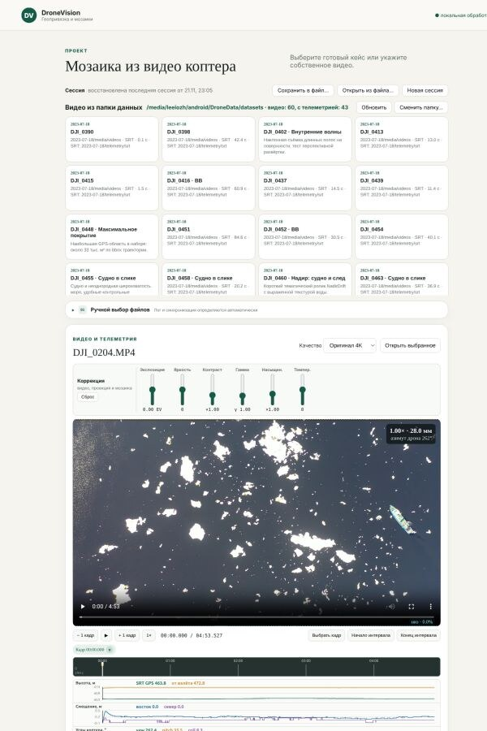
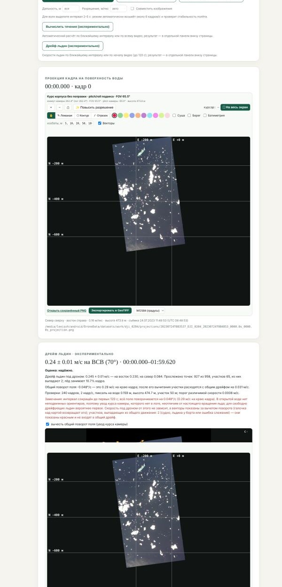

# DroneVision

Программа для геопривязки видео с дронов DJI: переносит кадры на карту в метрах и градусах и измеряет по ним
то, что видно на воде. Работает в браузере, но полностью на вашем компьютере — видео и логи никуда не отправляются.

## Что умеет

- **Проекция кадра** на поверхность воды: картинка «вид сверху» с сеткой, координатами, сушей, береговой линией и выбранными изобатами GEBCO.
- **Мозаика** из нескольких кадров и **осреднение** интервала видео (убирает блики и волны).
- **Сравнение** двух кадров или двух осреднённых интервалов на одной сетке: видно, что сдвинулось.
- **Разметка**: отрезки, ломаные и контуры; профили яркости вдоль линий, их совмещение и сравнение.
- **Смещение и скорость** отмеченных объектов (сликов, пены, льдин) между двумя кадрами.
- **Течения и спектр ветровых волн** по интервалу видео (экспериментально).
- **Дрейф льдин**: поле скоростей льдин по интервалу видео (экспериментально).
- **Экспорт**: PNG, GeoTIFF (WGS84 или UTM), TXT с профилями и векторами, CSV и JSON с течениями.

## Запуск

### Windows

1. На этой странице: зелёная кнопка **Code → Download ZIP**.
2. Распакуйте архив (правой кнопкой → «Извлечь всё…»), лучше в простой путь, например `C:\DroneVision`.
3. Дважды щёлкните `DroneVision.bat`.

Первый запуск идёт до 5 минут и требует интернета: программа сама готовит Python и всё нужное. Если Python у вас
уже установлен, используется он, и в нём ничего не меняется. Дальше программа запускается за секунды и без интернета.
Откроется чёрное окно и страница в браузере; окно должно оставаться открытым, пока вы работаете.

Если что-то не получилось — запустите `DroneVision-check.bat` и посмотрите [README_WINDOWS.txt](README_WINDOWS.txt).

### Linux

Нужны Python 3.10+ и `ffmpeg` (`sudo apt install ffmpeg python3-venv python3-tk`).

```bash
git clone https://github.com/leeiozh/DroneVision.git
cd DroneVision
chmod +x DroneVision.sh
./DroneVision.sh
```

`DroneVision.sh` создаёт отдельную `.venv`, докачивает недостающие библиотеки и запускает локальный сервис.
Окно терминала должно оставаться открытым. Ручной вариант запуска после подготовки окружения:
`.venv/bin/python -m dronevision web --open`.

Проверить, что всё на месте: `.venv/bin/python -m dronevision setup`.

## Какие файлы нужны

Для каждого видео нужны три вещи:

| Файл | Пример | Откуда |
|---|---|---|
| Видео | `DJI_0465.MP4` | карта памяти дрона |
| Субтитры с телеметрией | `DJI_0465.SRT` | там же (в настройках камеры должна быть включена запись субтитров) |
| Полётный лог | `DJIFlightRecord_2023-07-18_[09-40-06].txt` | телефон или пульт, папка `DJI/.../FlightRecord` |

Имена менять не обязательно: к имени видео можно дописать пояснение (`DJI_0465 Морская пена.MP4`), лог подбирается
к видео автоматически по GPS и времени.

### Как выгрузить полётные логи DJI Pilot

Подключите телефон или пульт к компьютеру кабелем и откройте его через «Этот компьютер». Для приложения **DJI Pilot**
нужная папка находится по пути:

`Phone → Android → data → com.dji.industry.pilot → files → DJI → com.dji.industry.pilot → FlightRecord`

Скопируйте всю папку `FlightRecord` в папку съёмки. Каждый вылет записан отдельным логом. У SRT и лога разные задачи:
SRT привязывает отдельные кадры к времени и содержит часть данных камеры, а FlightRecord содержит более полную и
частую телеметрию полёта — положение и ориентацию дрона и подвеса, скорость и момент взлёта. Поэтому для устойчивой
синхронизации, правильного курса и геометрии проекции нужны **оба файла**, а не только SRT.

## Куда положить и как указать

**Проще всего — одна папка с данными.** Сложите в неё видео, SRT и логи в любых подпапках, например:

```
DroneData/
  2023-07-18/
    DJI_0465.MP4
    DJI_0465.SRT
    FlightRecords/DJIFlightRecord_2023-07-18_[09-40-06].txt
```

При первом запуске нажмите **«Указать папку с данными…»** вверху страницы. Программа найдёт все видео, подберёт к ним
SRT и логи и покажет списком; папка запоминается. Видео, которым чего-то не хватает, показаны серым с пояснением.

Допустима и более сложная структура — важны не названия промежуточных папок, а сами файлы:

```
DroneData/
  Экспедиция-2026/
    04-ноября/
      video/DJI_0204.MP4
      subtitles/DJI_0204.SRT
      FlightRecord/DJIFlightRecord_2026-11-04_[09-12-24].txt
    GEBCO/gebco_2025_north.nc
```

Каталог просматривается рекурсивно. Если одинаковый номер `DJI_XXXX` встречается в нескольких вылетах, лучше держать
видео и его SRT рядом или внутри одной папки съёмки — это исключает неоднозначность.

**Одно видео без папки данных** открывается кнопкой **«Выбрать…»** в разделе «Файлы». SRT должен лежать рядом
с видео, логи — в той же папке или в `FlightRecords` рядом (до пяти уровней выше).

**Результаты** сохраняются в «Папку проекта» — по умолчанию `DroneVision-project` рядом с видео. Её можно сменить
в том же разделе «Файлы».

**Батиметрия** не скачивается программой автоматически. Скачайте нужный район на официальной странице
[GEBCO Gridded Bathymetry Data](https://www.gebco.net/data-products/gridded-bathymetry-data) в формате NetCDF (`.nc`) и
укажите файл в поле «Батиметрия GEBCO». В просмотрщике проекции или мозаики включите «Батиметрия» и впишите нужные
глубины через запятую, например `5, 10, 20, 50, 100`. Из многогигабайтного файла читается только небольшой прямоугольник
вокруг текущей съёмки; можно также указать папку с несколькими NetCDF-тайлами через настройку `bathymetry`.

## Первые шаги

### Что обязательно выбрать при первом открытии

1. **Папку с данными** — основной вариант для экспедиции с несколькими роликами. Если нужен один файл, можно вместо
   этого выбрать видео вручную в панели «Файлы».
2. **Видео из каталога**. У рабочей карточки должны быть найдены видео, SRT и FlightRecord; отсутствующий файл будет
   указан прямо на карточке.
3. **Папку проекта** в панели «Файлы». Туда пишутся сессия и все результаты; не выбирайте папку программы и не
   сохраняйте результаты на карту памяти дрона. Удобно создать отдельную `DroneVision-project` рядом с данными.
4. **«Взлёт над водой, м»** — высоту точки старта (палубы, берега, площадки) над уровнем воды. Без этой поправки
   масштаб на воде будет неверным.

GEBCO выбирается только если нужны изобаты. Береговые вырезки для уже подготовленных районов берутся из `maps/`.
Остальное подтягивается автоматически: программа сопоставляет SRT и FlightRecord по имени, времени и GPS, определяет
профиль камеры, синхронизирует часы, восстанавливает последнюю сессию и создаёт подпапки результатов. Если исходный
HEVC/4K-поток не воспроизводится браузером, в проекте автоматически создаётся совместимая 720p-копия только для
просмотра; расчёты и экспорт по-прежнему выполняются по исходному видео.



### За что отвечают панели

| Панель | Что в ней делать |
|---|---|
| **Сессия** | Сохранить работу в `.dvsession.json`, открыть сохранённую работу или начать новую. Автосохранение обновляется после действий. |
| **Папка с данными / Мозаика из видео коптера** | Просмотреть найденные съёмки, обновить каталог, сменить корневую папку и открыть карточку видео. |
| **Файлы** | Вручную указать видео, SRT, FlightRecord, папку проекта и GEBCO; проверить, что все пути доступны. |
| **Поправки и синхронизация** | Задать высоту взлёта над водой, временной сдвиг и поправки ориентации камеры. |
| **Видео и телеметрия** | Перематывать ролик, смотреть GPS/высоту/курс/наклон, выбирать кадры и границы интервала. |
| **Берег и выравнивание** | Наложить берег, вручную сдвинуть линию или автоматически подобрать курс/наклон и сохранить поправку. |
| **Проекция, мозаика и интервал** | Построить карту одного кадра, сравнение, мозаику или осреднение; запустить анализ течений, волн и льдин. |
| **Результат** | Включать сушу, берег и изобаты, рисовать отрезки/ломаные/контуры, сравнивать профили и экспортировать данные. |


### Базовый рабочий сценарий

1. **Откройте видео** из списка или кнопкой «Выбрать…». Под видео появятся телеметрия, дата и время съёмки и строка о синхронизации с логом.
2. **Проверьте привязку.** Задайте «Взлёт над водой, м» (высота точки взлёта над водой, например палубы).
   Если в кадре есть берег — раскройте плашку «Берег и выравнивание по нему», нажмите «Наложить береговую линию» и «Выровнять автоматически», затем
   «Сохранить выравнивание»: это исправляет курс и наклон камеры, которые в логе бывают сбиты на несколько градусов.
3. **Сделайте проекцию.** Остановите видео на нужном моменте, нажмите «Выбрать кадр», затем
   «Сделать проекцию выделенного кадра». Поля «Дальность, м» и «Разрешение, м/пкс» можно не трогать
   (пустая дальность — всё, что в кадре ниже горизонта; пустое разрешение — автоматическое).
   Щелчок по метке кадра или по границе интервала на видеодорожке возвращает видео к этому моменту,
   перетаскивание — переставляет метку; по графикам телеметрии тоже можно перематывать.
4. **Сравните два момента.** Выберите два кадра и нажмите «Сравнить 2 соседних кадра» — оба лягут на одну сетку,
   и между ними можно переключаться.
5. **Измерьте.** Инструментами «Отрезок», «Ломаная» и «Контур» отметьте объект одним цветом на обоих кадрах
   и нажмите «Рассчитать смещение и скорость». Отрезок сразу показывает профиль яркости.
6. **Для шумной поверхности** отметьте «Начало интервала» и «Конец интервала» (2–5 с) и нажмите
   «Осреднить выбранный интервал»; для нескольких кадров — «Сделать мозаику из выделенных кадров».
7. **Сохраните.** «Экспортировать в GeoTIFF» под картой, «TXT» у линии, «Сохранить все в TXT».



Для совмещения двух кадров выберите две близкие метки времени и нажмите **«Сравнить 2 соседних кадра»**. Программа
строит общую метрическую сетку: переключение `Кадр 1 / Кадр 2` не меняет координаты, поэтому одинаковая льдина или
граница слика должна смещаться только вследствие реального движения. Если берег или неподвижный объект «прыгает»,
сначала уточните курс по берегу и повторите проекцию. Отметьте объект одним цветом на обоих состояниях и используйте
«Рассчитать смещение и скорость».


Сессия сохраняется сама: при следующем запуске откроются то же видео, кадры, разметка и результаты.

Если страница пишет «Нет связи с локальным сервисом DroneVision» (старые версии браузера показывали `Failed to fetch`),
сервер остановлен: снова запустите `DroneVision.bat` или `DroneVision.sh`, оставьте его окно открытым и обновите страницу.

## Что и куда сохраняется

В папке проекта: `projections/` (проекции и сравнения), `mosaics/` (мозаики и осреднения), `profiles/`, `motion/`, `waves/`.

Имена файлов устроены одинаково:

`<взлёт>_<имя видео>_<начало видео>_<первое время>s_<последнее время>s_<тип>.<расширение>`

например `20230718T064006_DJI_0465_20230718T064512_0006.6s_0020.0s_compare1.png`. Взлёт (начало лога) и начало видео — UTC; времена — секунды от начала видео; тип —
`projection`, `compare1`/`compare2`, `mosaic`, `average`, `currents`, `motion`, у профилей — `lines` или `contours`.
Рядом с каждым PNG лежит `.geo.json` с геопривязкой, поправкой курса и сдвигом часов лога. Готовые файлы не перезаписываются:
повторный расчёт получает `_2`, `_3`.

## Подробнее

- [Краткая PDF-инструкция пользователя](docs/DroneVision_guide_ru.pdf) — все основные кнопки и пошаговые сценарии:
  проекция, мозаика, интервалы, профили, смещения, GeoTIFF/TXT и сессии.
- [docs/details.md](docs/details.md) — инструменты и методы подробно, настройка путей без интерфейса, командная строка.
- [docs/projection.md](docs/projection.md) — модель камеры и её проверка.
- [README_WINDOWS.txt](README_WINDOWS.txt) — памятка для пользователей Windows.
